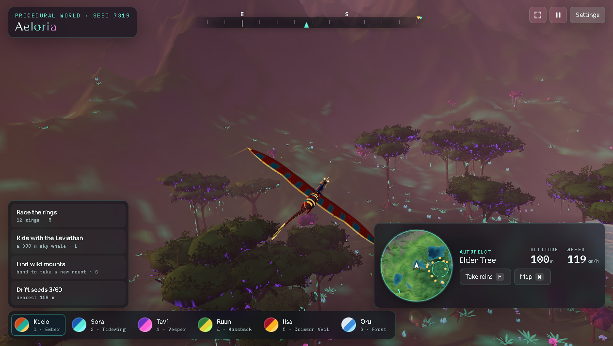

# AELORIA — offline mirror

Full mirror of **AELORIA** (https://aeloria.pokeable.app/), a procedural
bioluminescent world of floating mountains, giant trees and winged riders,
grown in the browser from a single seed.

Source: https://aeloria.pokeable.app/



## Stack

- **Vite production build** — hashed root-relative `assets/` chunks and the
  Vite modulepreload polyfill inside the app entry chunk (`assets/index-CBRcanzC.js`)
- **three.js r169** — its own vendor chunk (`assets/three-Bf1rlsf7.js`, license
  banner preserved)
- **React runtime chunk** — React/react-dom/react-reconciler + react-three-fiber
  + zustand in `assets/react-D7CucQ1e.js`
- **pmndrs/postprocessing v6.37.1** — inlined into the app chunk by the build,
  license-anchored (`postprocessing v6.37.1 build`, @license Zlib)
- **World generation in a module worker** — `assets/worker-BdHOuDMt.js` bundles
  the three.js worker core plus the app's seeded world builder
- **Everything else is procedural** — textures are painted to canvases, audio is
  synthesized with WebAudio (dozens of oscillator/gain call sites), trees,
  waterfalls and the minimap are generated from code: the capture carries no
  image, model, audio or font payloads
- **pokeable.app platform hosting** — per-game subdomain on Cloudflare; the
  platform injects the Cloudflare Web Analytics beacon and `/cdn-cgi/rum`

## What this is

AELORIA (aeloria.pokeable.app) — "A procedural bioluminescent world of floating
mountains, giant trees and winged riders, grown in your browser from a single
seed": pick a rider and their winged mount (Kaelo, Sora, Tavi, Ruun, Ilsa, Oru,
each with their own mount colours) and fly a seeded world — Hanging Peaks,
Elder Tree, Lumen Forest, Amber Plains, Mirror Lake — racing rings, collecting
drift seeds, bonding wild mounts and riding with a 300 m sky whale. By
@0xRhinoX, published on the pokeable.app game-hosting platform.

The capture is the whole runtime closure: 6 files, 1,359,953 bytes (1.36 MB) —
the entry document, the app entry chunk, the React runtime chunk, the three.js
r169 chunk, the world-generation worker chunk and the stylesheet. Closure was
iterated to fixpoint (static scan of every captured HTML/JS/CSS: script/link
refs, `new URL("…", import.meta.url)` worker paths, dynamic `import("…")`,
bare imports and asset-path string literals) and cross-checked against the
live browser's network log while actually playing: all five same-origin asset
requests matched the capture byte-for-byte (`decodedBodySize` 240,317 /
276,084 / 683,693 / 140,475 / 17,253), zero 404s from the game, zero off-origin
requests other than the two externals below.

External, at runtime, on this origin: the Google Fonts stylesheet
(Marcellus / Figtree / IBM Plex Mono — the game's type; kept CDN, never
backfilled) and the platform's Cloudflare Web Analytics beacon
(`static.cloudflareinsights.com`) plus its same-origin `/cdn-cgi/rum` POST.
Both are platform/telemetry-level and fail soft — the loopback boot test's
resource log is exactly the six captured files plus those externals, and the
game renders and flies with the beacon blocked (the loopback origin answers
`/cdn-cgi/rum` with a 404). Anything pokeable.app-platform-provided (hosting,
the beacon, the platform credit link in the credits panel) is noted as such in
this README, not captured as game content.

Upstream quirk (recorded, not a defect of the mirror): `assets/react-D7CucQ1e.js`
serves intermittently — some edge responses answer the entry document
(HTTP 200 `text/html`, the static host's SPA fallback) instead of the chunk.
The capture holds the real 200 `text/javascript` bytes (re-probed repeatedly),
and `tools/update.mjs` retries once and records such responses as `fallback`
known-noise rows instead of drift.

## Layout

- `index.html` — the entry document as served to browsers (byte-exact, 2,131 B;
  the browser-variant bytes include the platform-injected Cloudflare beacon tag)
- `assets/` — the five captured files as served: `index-CBRcanzC.js` (app entry
  chunk), `react-D7CucQ1e.js` (React runtime chunk), `three-Bf1rlsf7.js`
  (three.js r169), `worker-BdHOuDMt.js` (world-generation worker),
  `index-Ctb6YBeZ.css` (stylesheet)
- `.upstream/manifest.json` — Gen-A sha256 record for all 6 captured files
- `readable/assets/` — prettified derived layer (pinned prettier 3.9.6, module
  API, served paths kept): `index-CBRcanzC.pretty.js`,
  `worker-BdHOuDMt.pretty.js`, `react-D7CucQ1e.pretty.js`,
  `three-Bf1rlsf7.pretty.js` and `index-Ctb6YBeZ.pretty.css`
- `src/assets/` + `split-spec.json` — 30 statement-aligned slices of the two app
  chunks in served-path form (`index-CBRcanzC-NN.js` ×24, `worker-BdHOuDMt-NN.js`
  ×6), re-cut through the recorded semantic rename map, with the derivation
  record (36 sections)
- `rename-map.json` — the recovered per-slice rename layer (`files`
  word-boundary + `scoped` token-index records) over `src/`
- `legacy/2026-10-14/` — the superseded derived layer (the previous flat-named
  `readable/` + 30-slice `src/` + its `split-spec.json`), kept as the rollback
  copy
- `tools/derive.mjs` — rebuild `readable/` + `src/` + `split-spec.json` (re-applies
  the recorded rename map)
- `tools/apply-names.mjs` — apply the reviewed renames (`tools/names.json`)
- `tools/recover-scoped-map.mjs` — record the achieved map into `rename-map.json`
- `tools/verify-rename.mjs` — per-slice rename gate (reproduces/references/bindings)
- `tools/check-chunk.mjs` — whole-chunk gate (re-splice + cross-slice resolve)
- `tools/refcheck.mjs`, `tools/engine/rename-layer.mjs` — the shared
  scope/token engine the rename tools use (acorn from `tools/.deps`, gitignored)
- `tools/serve.mjs` — loopback static server used for the serve probe
- `tools/verify.mjs` — re-hash the capture against the manifest
- `tools/update.mjs` — read-only drift probe against the live origin
- `tools/audit.js` — integrity gate for the derived layers and the rename map
  (`AUDIT PASS`)
- `docs/cover.png`, `docs/boot-2026-10-13.png` — cover + boot evidence (both
  captured in actual gameplay against the served mirror: rider on the wing
  over the glowing canopy, HUD with altitude/speed and the minimap in frame)

## Assets

none — code/docs only. The capture carries no image, model, audio or font
payloads: the game paints its textures to canvases, synthesizes its audio with
WebAudio and grows the entire world in code (the seeded world builder in
`assets/worker-BdHOuDMt.js`); the only library asset is the three.js vendor
chunk. The favicon is an inline `data:` SVG. Fonts come from the Google Fonts
stylesheet (external, never captured).

## Run

Serve the repo root with any static file server (the capture is a static site;
no build step):

```
npx serve .
```

The game boots at `http://localhost:3000/` and grows a seeded world (append
`?seed=NNNN` to pick a seed; a `?debug` flag exposes `window.aeloria`).

## Verify

```
node tools/verify.mjs                # re-hash the capture against the manifest
node tools/audit.js                  # derived-layer + rename-map integrity gate
node tools/verify-rename.mjs --all   # rename layer: reproduces/references/bindings
node tools/check-chunk.mjs --all     # re-splice + cross-slice resolve
node tools/check-exports.mjs         # the derived layer still exports every public name
```

Last run: `6 files checked, 0 problems` and `AUDIT PASS`.

Rebuild the derived layers from the frozen capture (byte-identical, proven):

```
node tools/derive.mjs && node tools/apply-names.mjs --all && node tools/recover-scoped-map.mjs
```

## Updating from upstream

```
node tools/update.mjs     # read-only drift probe: what changed upstream
```

The probe never rewrites the capture — a mirror is a point-in-time snapshot.
Refreshing means re-fetching the full runtime closure into a clean tree, copying
every replaced file into `legacy/<date>/`, re-cutting `.upstream/manifest.json`,
and re-deriving `readable/` + `src/` from the new bytes with
`node tools/derive.mjs`. After a refresh the chunk hashes change, so the rename
layer is re-cut with the new bytes: `tools/derive.mjs` re-applies the recorded
`rename-map.json` where the chunk shape is unchanged; a changed chunk makes
`tools/apply-names.mjs` (which keys on the capture rels and the pristine
readable ranges) refuse loudly rather than rename the wrong spans — re-author
the batch, then re-run `apply-names.mjs --all` → `recover-scoped-map.mjs` and
the four gates (`audit.js`, `verify-rename.mjs`, `check-chunk.mjs`, `verify.mjs`).
Known noise rows: `_mirror-report.json` is a local
capture record and is never probed (excluded by name); `cdn-cgi/` is platform
telemetry and is never probed; a 200 `text/html` body on a non-HTML captured
file is the static host's SPA fallback (see the upstream quirk above) and is
recorded as `fallback` noise, not drift.

### 2026-10-13 readable/src derivation

> **Superseded in part 2026-10-14** by the structure pass + rename campaign
> below: `readable/` and `src/` were re-rooted onto the served paths and the
> rename layer was applied, so the flat names (`assets__…`-prefixed) and the
> minified identifiers quoted here describe the previous layer only. Kept as
> the record of the first-cut derivation (the superseded bytes live at
> `legacy/2026-10-14/`).

Both queued derived layers are in place, cut from the recorded capture (capture
bytes untouched — `node tools/verify.mjs` re-hashes all 6 files):

- `readable/` — pinned prettier 3.9.6 (module API, default options, single pass
  verified idempotent — never the CLI, it respects `.gitignore` and can silently
  echo its input) rendered the four captured JS chunks to `*.pretty.js` (70,816
  lines: app entry 11,088; React runtime 17,448; three.js 33,397; worker 8,883)
  and the stylesheet to `*.pretty.css` (1 file, 1,211 lines). Names are
  capture-relative with `/` flattened to `__` (`assets__index-CBRcanzC`, …).
  Every pretty is provably not a byte copy of its capture source and re-renders
  byte-exact under the pinned version.
- `src/` — 30 statement-aligned slices (`src/<tag>-NN.js`, exact 2-line
  provenance header) recorded in `split-spec.json` (36 sections): 30/30 parse
  standalone (`node --input-type=module --check -`) and round-trip byte-exact to
  their readable line ranges. Cuts land only on top-level declaration
  boundaries (~250–350 line windows); oversized single declarations stay whole
  (largest: `assets__index-CBRcanzC-18.js`, 1,536 lines — the engine class,
  kept whole; the sky-whale/leviathan class follows at 568). Identification is
  the bundle's own minified names — the rename campaign (PLAN §5) remains an
  open task in this README.
- Vendor rule — wholeFile sections, never sliced (6): the three.js r169 build
  (`assets/three-Bf1rlsf7-vendor.js`), the React runtime chunk
  (`assets/react-D7CucQ1e-vendor.js`: React/react-dom/react-reconciler +
  react-three-fiber + zustand), the bundled three.js r169 worker core inside
  `assets/worker-BdHOuDMt.js` (content-anchored: it ends at the classic
  `__THREE__`/`__THREE_DEVTOOLS__` module tail and the app's world builder
  resumes right after), the inlined pmndrs/postprocessing v6.37.1 region inside
  the app chunk (license-anchored, asserted between the app's camera code and
  its wing builder), the Vite modulepreload polyfill (build machinery) and the
  stylesheet.
- Non-standalone parts would be indexed as skipped sections; this capture has
  none (no pure trailing export tables — the chunks end in code, and vendor
  export tables live inside wholeFile vendor sections). Non-code payloads:
  zero (`notRendered: 0`). Inline entry blocks: zero — `index.html` references
  external resources only (module script, modulepreload links, stylesheet,
  Google Fonts, the platform beacon), so there are no `*-inline-N` twins and no
  `readable/index-inline-map.json`.
- Gates: `node tools/verify.mjs` → `6 files checked, 0 problems`;
  `node tools/audit.js` → `AUDIT PASS` (30/30 round-trips, 5/5 pretties
  re-render byte-exact, 5/5 pretty sources tiled, 3/3 imports resolve inside the
  capture — the two chunk imports and the `new URL("/assets/worker-BdHOuDMt.js",
  import.meta.url)` worker path); `node tools/update.mjs` → `up to date: 6
  captured files identical upstream`; serve probe — mirror root served on
  loopback (entry + all five assets over HTTP 200, bytes identical to the
  capture), listener killed, port 4311 closed (netstat + connection refused).
  Boot evidence and cover are real gameplay (`docs/boot-2026-10-13.png`,
  `docs/cover.png`) — the seeded world grown in the worker, rider on the wing
  over the glowing canopy, HUD with altitude/speed and minimap in frame,
  captured through the opencli browser against the served mirror; its resource
  log matched the 6-file capture exactly. Rebuild with `node tools/derive.mjs`.
- §0.4 fork-over-mirror checked 2026-10-13: the page and all five captured JS
  files were scanned for a public source repo — every `github.com` reference is
  a library credit (`github.com/pmndrs/postprocessing`,
  `github.com/pmndrs/zustand/discussions/1937`,
  `docs.pmnd.rs/react-three-fiber`), plus the author's `x.com/0xRhinoX` and the
  platform's `pokeable.app` credit link; no project's own repository is
  referenced or published, and a GitHub search finds nothing — the platform
  publishes the deployment only, so the mirror stands.

### 2026-10-14 structure pass + identifier rename campaign (the open task, closed)

Mission of this pass: converge `readable/` and `src/` on the real project shape
and run the PLAN §5 identifier rename campaign. The capture was **not** touched
— `node tools/verify.mjs` still re-hashes all 6 files (0 problems) — so this
section is entirely about `readable/`, `src/`, `split-spec.json`,
`rename-map.json` and `tools/`.

- **Inventory (source maps + module boundaries) — both negative, recorded**:
  - *Source maps*: zero `sourceMappingURL` occurrences across the capture
    (index.html + all five assets) and no `.map` file in it, so no original
    tree can be reconstructed from maps; the derivation stays the
    prettier/slice pass.
  - *Module boundaries*: the capture is a Vite ES-module build — the entry
    chunk opens with the Vite modulepreload polyfill, imports its two vendor
    chunks with real `import` statements and ends in code (no export table);
    the worker chunk is a single top-level statement list (bundled three.js
    core + the app's world builder) ending in its `self.onmessage` handler.
    There are no webpack/Turbopack-style factory tables or registries, so the
    factory-family module-extraction precedents (spawn-dust-2-dm / kettuvellam
    / futbol-island / nba-2k) are **not applicable**; the boundaries the bundle
    really exposes are the two app chunks themselves (entry + worker) plus the
    in-chunk vendor/machinery seams.
- **Structure — `readable/` and `src/` now mirror the served paths** (PLAN §5:
  "the served path is the truth"): a captured file at
  `assets/index-CBRcanzC.js` derives to `readable/assets/index-CBRcanzC.pretty.js`
  and slices to `src/assets/index-CBRcanzC-NN.js`; `__`-flattening is gone. The
  two app chunks the build exposes are the file split
  (`src/assets/index-CBRcanzC-*.js` ×24, `src/assets/worker-BdHOuDMt-*.js` ×6);
  inside each, the statement-aligned slice remains the true boundary (no module
  tables, no maps). Slice headers carry the served tag
  (`// assets/index-CBRcanzC 07 — …`); the index-only section names read as
  served paths too (`assets/three-Bf1rlsf7-vendor.js`,
  `assets/react-D7CucQ1e-vendor.js`,
  `assets/worker-BdHOuDMt-three-vendor.js`,
  `assets/index-CBRcanzC-postprocessing-vendor.js`,
  `assets/index-CBRcanzC-polyfill-machinery.js`,
  `assets/index-Ctb6YBeZ-stylesheet.css`). Before/after: `readable/` 5 flat
  pretties → 5 under `readable/assets/` (bytes unchanged, path-only
  re-rooting); `src/` 30 flat slices → 30 under `src/assets/`; section count
  unchanged (36). The superseded flat-named derived layer (previous
  `readable/` + 30-slice `src/` + its `split-spec.json`) is archived at
  `legacy/2026-10-14/`.
- **Rename campaign (PLAN §5) — applied and gated**: `tools/names.json` is the
  reviewed worklist (234 rules for the entry chunk + 49 for the worker, every
  name read out of the code's own strings/structure), applied by
  `tools/apply-names.mjs` as **283 names / 2,155 identifier splices** on the
  chunks' top-level bindings and import aliases, recovered into
  `rename-map.json` (**655 word-boundary records + 18 indexed names over 106
  occurrences** across all 30 slices) by `tools/recover-scoped-map.mjs`, and
  re-applied by `tools/derive.mjs` on every re-cut. Highlights: the engine
  (`AeloriaEngine`, `createSkyMaterial`, `createWaterMaterial`,
  `createWaterfallMaterial`, `createRain`, `createBioMaterial`, `applyBioFog`,
  `paintGeometry`, `mergePaintedParts`), the world
  (`Terrain`, `worldSize`/`worldBoundary`/`waterLevel`, `createSeededNoise`,
  `mulberry32`, `perlinGradients`), the creatures (`Mount`, `WildMount`,
  `FlockManager`, `buildMountBody`, `buildRiderFigure`, `animateWings`,
  `tubeFromCurve`, `buildRibbon`, `buildWingGeometry`), the leviathan
  (`Leviathan`, `whaleLength`/`whaleSpineRadius`/`whaleSpineSegments`,
  `leviathanProfile`, `profileWidth`/`profileHeight`/`profileRadius`, the
  whale GLSL chunks), flight (`flightState`, `gravity`, `coastDrag`,
  `tuckDrag`, `maxThrust`, `minSpeed`, `wrapAngle`, `upAxis`), the game systems
  (`SeedField`, `RaceRings`, `CameraRig`, `SoundEngine`, `InputController`,
  `BirdFlock`, `TrailRibbons`, `SplashParticles`, `createSpeedLines`,
  `resolveSolidCollision`/`resolveBoxCollision`), the world-generation worker
  (`generateWorld`, `createSeededNoise`, `landmarkTable`, `qualityPresets`,
  `buildForestTrees`/`buildGroveTrees`/`buildSmallTrees`/`buildVineColumns`,
  `buildTree`/`buildShrub`/`buildFern`/`buildMushroom`/`buildLumenPlant`/
  `buildBloomPlant`, `buildRock`/`buildStoneArch`/`buildBlob`,
  `buildHeightField`, `buildGrassBlades`, `buildGrassGeometry`), and the React
  UI layer (`useGameStore`, `showToast`, `preferences`, `App`, `TopBar`,
  `FlightPanel`, `SkyPanel`, `SettingsPanel`, `RiderRoster`, `BondPanel`,
  `ActivitiesPanel`, `WorldMapPanel`, `TouchControls`, `PauseMenu`,
  `IntroOverlay`, `LoadingOverlay`, `Toast`, `R3FCanvas`, `useThree`,
  `useFrame`, `useShallow`, `FrameLoop`, `KeyboardShortcuts`, `PresenceClient`).
- **What the campaign deliberately does not rename** (honest scope):
  - **vendor identifiers** — the wholeFile regions (three.js r169 chunk, React
    runtime chunk, the worker's bundled three.js core, the Vite modulepreload
    polyfill, the inlined pmndrs/postprocessing region) are never rewritten and
    carry no records; they stay minified by construction.
  - the app entry chunk's ~15 aliases the inlined postprocessing region shares
    (`W`, `ae`, `D`, `k`, `I`, `pt`, `te`, `Ze`, `le`, `$`, `Q`, `et`, `Pi`,
    `Os`, `Ce`) — `tools/apply-names.mjs` refuses a rename whose binding is
    referenced inside a region that is never rewritten (the same guard stillwater
    documented for `q`); the region is vendor code and stays byte-exact.
  - `H` and `q` (two extra `Vector3` aliases) — cannot be mapped onto the
    `Vector3` target without creating a duplicate declaration; recorded, not
    forgotten.
  - the remaining 21 three/postprocessing type constants with no app-side
    evidence (`Me`, `wi`, `bi`, `Si`, `Mi`, `R`, `Ke`, `Jt`, `Us`, `Ls`, `hs`,
    `Ti`, `ki`, `Ae`, `Is`, `js`, `Hs`, `Ci`, `Fi`, `Ni`, `_i`) — left
    minified. Coverage: 234 of the entry chunk's 272 app-region top-level
    bindings and all 49 of the worker's are named; 38 short spellings remain on
    the entry side (15 region-shared + `H`/`q` + the 21 above).
  - **locals inside function bodies** — the campaign renames top-level bindings
    and import aliases only (the same declared scope as the precedents);
    function-local short names stay minified.
- **Gates (verbatim tails, 2026-10-14)**:

```
node tools/verify.mjs
6 files checked, 0 problems

node tools/audit.js
AUDIT PASS — 36 spec sections (30/30 src↔pretty round-trips byte-exact through the recorded rename map, 30 renamed slice(s), 5/5 pretty sources tiled contiguously, 0/0 skipped export-table sections re-verified textually, 30/30 derived slices + 4/4 readable/*.pretty.js parse standalone (node --input-type=module --check -), 5/5 pretties provably distinct from their capture source, 6 index-only wholeFile/skipped sections carry no src file, 0 inline content block(s) with twins + index-inline-map.json, 3/3 imports resolve inside the capture (0 whitelisted machinery), rename map: 655 word-boundary record(s) + 18 indexed name(s) over 106 occurrence(s) (mapOK 43 slice(s) token-validated, no foreign position), 5/5 pretties re-render byte-exact under pinned prettier 3.9.6, capture manifest free of derived layers)

node tools/verify-rename.mjs --all
verify-rename: 30/30 slice(s) reproduce byte-exact, 30 renamed slice(s) (106 indexed occurrence(s)), 2/2 chunk(s) references+bindings YES

node tools/check-chunk.mjs --all
check-chunk: 2 chunk(s), 30 slice body(ies) substituted — all cross-slice calls resolve

node tools/update.mjs
up to date: 6 captured files identical upstream
```

- Derive re-run reproducibility: full-pipeline re-run
  (`derive.mjs && apply-names.mjs --all && recover-scoped-map.mjs`) reproduces
  **all 37 derived entries byte-identical** (readable 5 + src 30 +
  `split-spec.json` + `rename-map.json`); the derive's own self-check tail:
  `derive: 5 readable file(s), 30 src slices (30/30 parse standalone, 30/30
  round-trip byte-exact through the recorded map, 30 renamed slice(s)),
  0 skipped, 6 wholeFile, 4 pretty js parse clean, 0 notRendered, 0 orphan(s)
  pruned — self-check clean`.
- Serve probe (capture bytes unchanged, so the 2026-10-13 boot/cover evidence
  stands; the read-only probe re-confirms the mirror serves the game): loopback
  `node tools/serve.mjs 4311` — `/` and `/index.html` (2,131 B),
  `/assets/index-CBRcanzC.js` (240,317 B), `/assets/index-Ctb6YBeZ.css`
  (17,253 B), `/assets/react-D7CucQ1e.js` (276,084 B),
  `/assets/three-Bf1rlsf7.js` (683,693 B), `/assets/worker-BdHOuDMt.js`
  (140,475 B) and the derived `/readable/assets/index-CBRcanzC.pretty.js`
  (350,050 B) + `/src/assets/index-CBRcanzC-01.js` (1,636 B) all HTTP 200;
  listener killed (PID), port 4311 proven closed (`netstat`: no LISTENING row;
  curl: connection refused). `tools/serve.mjs` also had one real defect fixed
  by this probe: a malformed request target (`//`) threw out of
  `new URL(req.url, …)` on Node 26 and crashed the server — the handler now
  falls back to the root path.
- Record tools stay manifest-driven (`verify.mjs` / `update.mjs` never walk the
  tree), so `src/`, `legacy/`, `split-spec.json`, `rename-map.json` and
  `_mirror-report.json` cannot enter the capture record — `audit.js` re-checks
  that.

## Mirror conventions

- **Capture layer** — the captured files are byte-exact copies of what the
  origin served; nothing in them is edited. Vendor files (three.js, React) stay
  byte-exact exactly as served — never re-minified or re-hosted.
- **Readable layer** — `readable/` is derived (prettified) and never shipped to
  a browser; it exists so the bundles can actually be read.
- **Provenance** — `.upstream/manifest.json` records sha256 for each captured
  artifact, and `tools/verify.mjs` re-checks it.
- **Drift** — `tools/update.mjs` is read-only: it reports what changed upstream
  and never rewrites the capture.
- **Rename layer** — `rename-map.json` is the recorded semantic rename map over
  `src/` (word-boundary + token-index records, recovered mechanically); a
  re-cut re-applies it (`tools/derive.mjs`), and `tools/verify-rename.mjs`,
  `tools/check-chunk.mjs` and `tools/audit.js` re-prove it. Vendor identifiers
  stay minified by construction. The PLAN §5 identifier rename campaign is
  **closed** (2026-10-14); the honest limits are recorded above.

## Fleet status

<!-- mirror-status:start — feeds _standard/REPO-INDEX.md. Update ONLY your own mirror's block; never edit the shared index (PLAN §8). Rebuild: node _standard/build-index.mjs -->
<!-- cols: cls=classification · ver=verify 0 problems · upd=drift probe · man=manifest · rdbl=readable re-derived · src=reversed src · boot=boot test · top=offline-mirror topic · tag=backup tag · staged=staged not committed -->
| # | repo | cls | ver | upd | man | rdbl | src | boot | top | tag | staged |
|---|---|---|---|---|---|---|---|---|---|---|---|
| 292 | aeloria | mirror | ✓ | ✓ | ✓ | ✓ | ✓ | ✓ | ✓ | — | — |
<!-- mirror-status:end -->
